<!-- The cards in assets/ are generated by src/build.mjs (npm install && npm run build). -->


  


  


<a href="https://github.com/Nabilislam722/Mintora"></a>

<a href="https://github.com/Nabilislam722/HairGames"></a>
<a href="https://github.com/Nabilislam722/Web3-Games"></a>

<a href="https://github.com/Nabilislam722/esp32-realtime-dashboard"></a>
<a href="https://github.com/Nabilislam722/AVR_programs"></a>

  


  


  


  


  


  

<picture>
  <source media="(prefers-color-scheme: dark)" srcset="https://raw.githubusercontent.com/Nabilislam722/Nabilislam722/output/snake-dark.svg">
  
</picture>

  


  

&nbsp;
&nbsp;
&nbsp;

  

