<!-- The cards in assets/ are generated by src/build.mjs (npm install && npm run build). -->

  

  

  

  

  

  

  

<picture>
  <source media="(prefers-color-scheme: dark)" srcset="https://raw.githubusercontent.com/Nabilislam722/Nabilislam722/output/snake-dark.svg">
  
</picture>

  

  

&nbsp;
&nbsp;
&nbsp;

  

